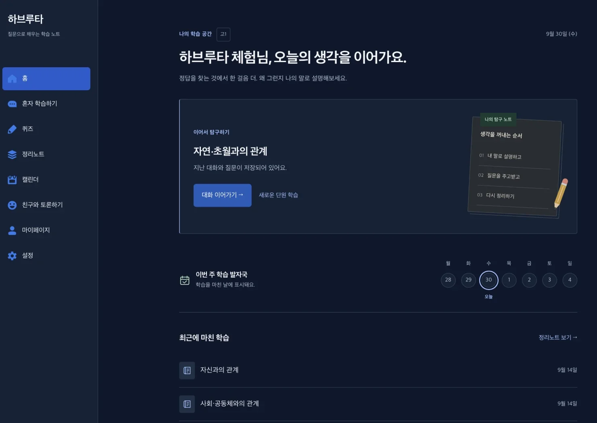
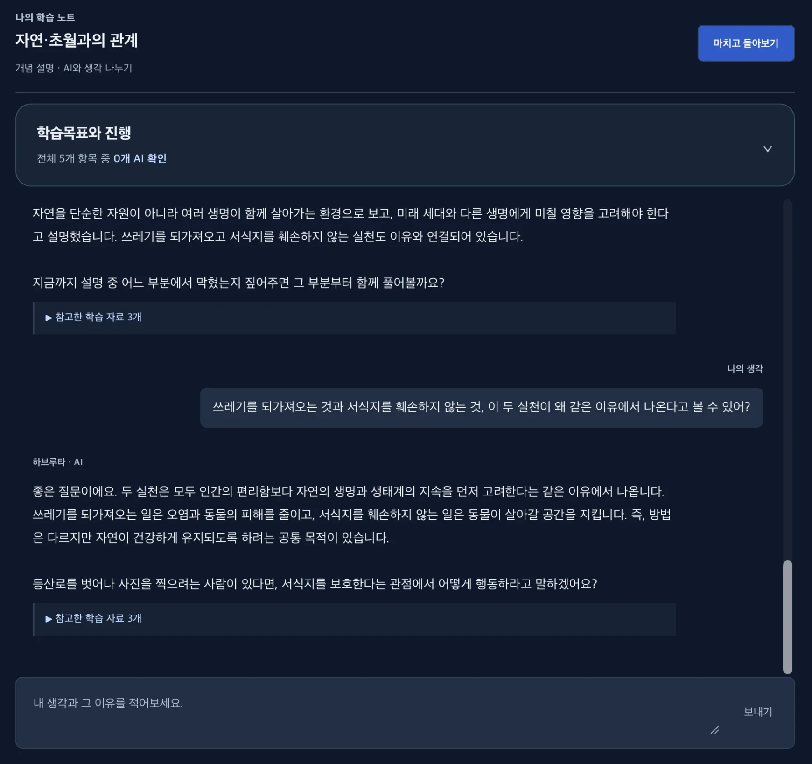
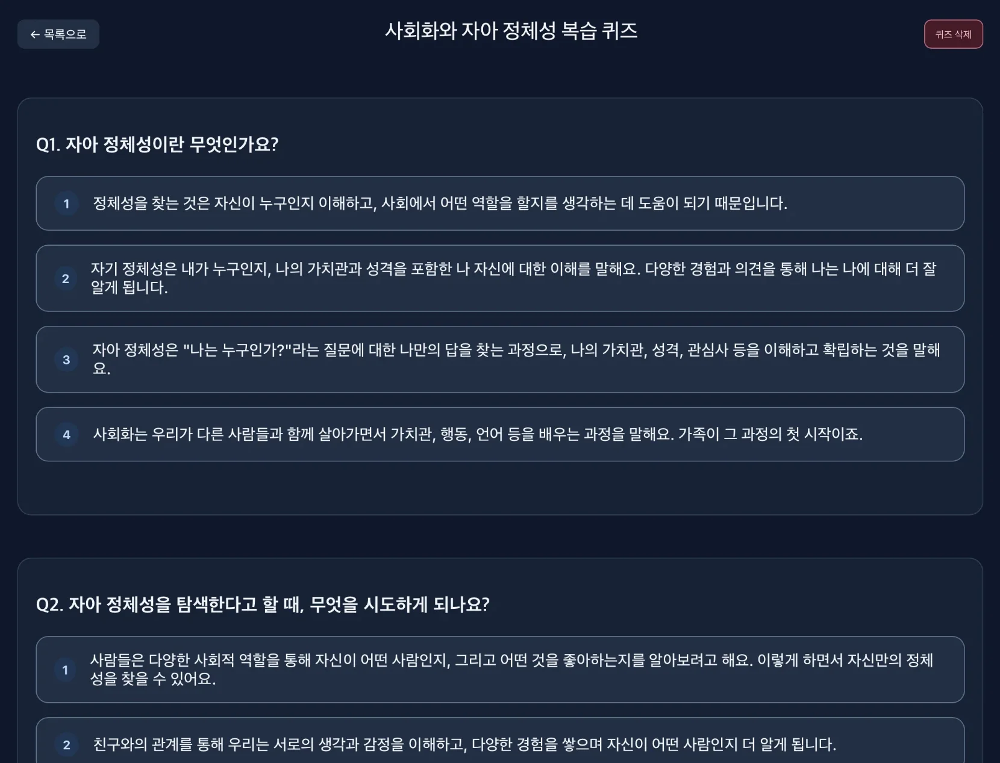
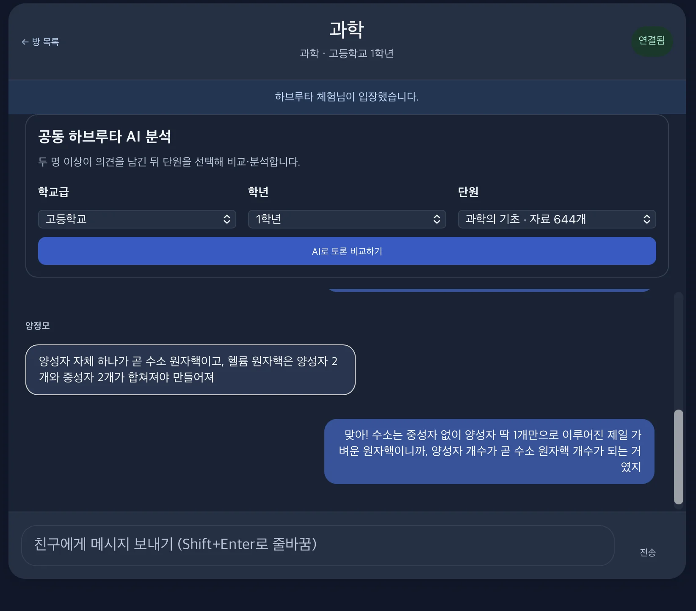

고등학생이 AI에게 답을 받기만 하는 서비스가 아니라, **자기 언어로 설명하고 피드백을 받는** 하브루타 학습 웹앱입니다.

- **GitHub:** [20211400jiho/havruta-ai-tutor](https://github.com/20211400jiho/havruta-ai-tutor)
- **웹앱:** [공개 테스트](https://frontend-production-8c41.up.railway.app)
- **API / Swagger:** [docs](https://backend-production-98f3.up.railway.app/docs)
- **역할:** 팀 프로젝트 / 백엔드·AI·브랜치 통합·배포

## 학습 흐름

1. 학생이 학습 주제를 선택한다.
2. AI가 학습 자료에 근거한 첫 질문을 제시한다.
3. 학생이 자기 언어로 개념이나 풀이를 설명한다.
4. 시스템이 답변을 평가하고 강점과 개선점을 알려준다.
5. AI가 다음 사고를 유도하는 후속 질문을 제시한다.
6. 학습 종료 시 기록과 정리노트를 자동 생성한다.
7. 같은 학습 자료를 사용해 복습 퀴즈를 생성한다.

## 화면으로 본 학습 흐름

학생이 실제로 거치는 순서대로 네 화면을 놓았습니다. 홈에서 시작해 AI와 대화하고, 퀴즈로 복습하고, 친구와 토론합니다. 대화·퀴즈·토론 모두 학생이 고른 단원의 교육과정 자료를 근거로 동작합니다.

### 1. 홈: 이어서 할 학습

홈은 지난 학습에서 이어지도록 구성했습니다. `이어서 탐구하기`에는 마지막으로 공부하던 단원이 뜨고, 지난 대화와 질문이 저장되어 있어 `대화 이어가기`로 바로 돌아갈 수 있습니다. `이번 주 학습 발자국`은 학습을 마친 날을 표시하고, `최근에 마친 학습`은 세션 종료 때 만들어진 정리노트로 이어집니다.

{: .shadow .rounded-10 }
_하던 학습으로 돌아가는 입구입니다. 끝낸 학습은 정리노트로 남습니다._
{: .fig-caption }

### 2. AI와 학습 대화: 설명하고, 되묻고

위 흐름의 2~5번이 일어나는 화면입니다. 학생이 자기 말로 설명하거나 질문하면, AI가 답한 뒤 다음 생각을 끌어내는 질문으로 되묻습니다. 대화는 학습 시작 때 고른 `교과목 · 학교급 · 학년 · 단원` 안에서만 자료를 검색합니다. 원래 `AITraining` 브랜치에 있던 자료는 고1 수학 JSON 하나뿐이었고, 통합하면서 학교급과 과목을 골라 들어갈 수 있게 넓혔습니다.

답변마다 `참고한 학습 자료 3개`를 펼치면 근거로 쓴 교육과정 자료를 볼 수 있습니다. 위쪽 `학습목표와 진행`은 이 단원의 학습목표 중 AI가 확인한 항목 수를 보여줍니다.

{: .shadow .rounded-10 }
_AI가 설명으로 끝내지 않고 다음 질문을 던집니다. 근거 자료는 답변마다 펼쳐 확인합니다._
{: .fig-caption }

### 3. 복습 퀴즈

공부한 단원의 학습 자료를 검색해 복습 퀴즈를 만듭니다(흐름 7번). 근거가 될 자료를 찾지 못하면 퀴즈를 만들지 않고 오류를 돌려줍니다. 자료 없이 그럴듯한 문제를 지어내지 않게 하려는 선택입니다.

{: .shadow .rounded-10 }
_퀴즈도 대화와 같은 단원 자료에서 나옵니다._
{: .fig-caption }

### 4. 친구와 토론: 실시간 채팅과 AI 비교

혼자 하는 학습과 별도로, 같은 학습방의 친구들과 WebSocket으로 실시간 채팅을 합니다. 연결할 때 JWT와 학습방 권한을 확인합니다.

`AI로 토론 비교하기`는 서로 다른 두 명 이상이 의견을 남겼을 때만 분석을 시작합니다. 선택한 단원의 자료를 검색해 근거로 삼고, 참여자별 최근 의견의 공통점과 차이를 비교한 뒤 다음 토론 질문을 제시합니다. 단원 선택지 옆의 `자료 644개`는 그 단원에서 근거로 쓸 수 있는 자료 수입니다.

{: .shadow .rounded-10 }
_사람끼리의 대화는 WebSocket으로 주고받고, 비교·정리는 AI가 단원 자료를 근거로 합니다._
{: .fig-caption }

## 통합이 필요했던 이유

원래 저장소는 역할이 갈라져 있었습니다.

| 브랜치 | 원래 역할 |
|--------|-----------|
| `main` | 백엔드 (회원, 학습방, WebSocket) |
| `AITraining` | 고1 수학 JSON + Chroma 검색 실험 |
| `front` | React/Vite 화면 |

각각은 동작했지만, 처음부터 끝까지 한 서비스로 실행하기는 어려웠습니다. 백엔드·AITraining·프런트를 하나의 실행 가능한 MVP로 합치고, 더미 화면을 실제 API에 연결하는 작업을 진행했습니다.

## 아키텍처

`AI_PROVIDER=openai`이면 선택한 과목의 ChromaDB 검색 근거를 OpenAI에 전달합니다. API 키가 없거나 호출이 실패하면 규칙 기반 답변으로 대체합니다. RAG가 없으면 MySQL 어휘 검색으로 폴백합니다.

## 구현 범위

- 이메일 회원가입/로그인, Argon2 해싱, JWT 인증
- 학습방 생성, 6자리 초대 코드 참여, 인원 제한
- 과목별 학습방과 AI 세션, 답변 평가, 후속 질문
- 고1 수학 자료 10건 자동 DB 인덱싱
- 학습 종료 시 정리노트, RAG 기반 복습 퀴즈
- 홈 통계, 캘린더, 마이페이지 실데이터 연동
- JWT·학습방 권한 검사를 적용한 실시간 그룹 채팅
- 두 명 이상의 토론 의견을 단원 자료 근거로 비교하는 공동 하브루타 AI 분석
- Railway Docker 배포 (MySQL · Redis · Backend · Frontend)
- SQLite 단위/통합 테스트와 MySQL HTTP 스모크 테스트 (자동 테스트 196개 통과, 2026.11 기준)
- 9개 과목 302,059건의 검색 자료를 운영 서버의 영속 볼륨에 준비
- AI가 "이해했다"고 판단해도, 근거 문장이 실제 학생 답변에 있고 인용한 출처가 실제 검색 결과에 있을 때만 학습 단계를 올리는 서버 검증

## 기술 스택

- Backend: Python, FastAPI, SQLAlchemy, MySQL, Redis, JWT
- Frontend: React, Vite
- AI: OpenAI Responses API, ChromaDB, BM25·RRF 재정렬, 선택적 Ollama
- Infra: Docker, Railway

## 검색을 고쳤다고 말하기 전에: 비교 실험 (2026.10)

검색은 ChromaDB 의미 검색으로 후보 15개를 찾고, 그 안에서 BM25 순위와 벡터 순위를 RRF로 합쳐 3개만 근거로 넘깁니다. 이 재정렬이 실제로 도움이 되는지, 그리고 새로 만든 개선안을 운영에 올려도 되는지를 직접 측정했습니다.

### 실험 1. 재정렬만 바꾸면 달라지는가

과학 6개, 사회 6개 질문을 검색 전에 고정하고, 검색 질의와 후보 15개를 똑같이 둔 채 재정렬만 바꿨습니다.

| 비교군 | 근거 확보 Hit@3 | 직접 근거 Precision@3 | MRR@3 |
|---|---:|---:|---:|
| A. 학생 답변만으로 벡터 검색 | 8/12 = 66.7% | 16/36 = 44.4% | 0.528 |
| B. 대화 맥락을 넣은 질의로 벡터 검색 | 8/12 = 66.7% | 12/36 = 33.3% | 0.528 |
| C. B와 같은 후보에 BM25·RRF 재정렬 | 9/12 = 75.0% | 16/36 = 44.4% | 0.667 |

B에서 C로, 재정렬만 바꿨을 때 Hit@3는 8.3%p, Precision@3는 11.1%p 올랐습니다. 역할 갈등을 묻는 질문에서는 벡터 순위 7·8·12위에 있던 해결 방법 자료가 1·2·3위로 올라왔습니다. 반대로 A에서 B로 대화 맥락을 더했을 때는 Hit@3가 그대로였고 Precision@3는 11.1%p 내려갔습니다. 단계를 붙일수록 좋아진다는 가정은 틀렸습니다.

### 실험 2. 개선안을 운영에 올릴 것인가

본문에서 반복 메타데이터를 걷어내고 질문 중심으로 재정렬하는 개선안을 구현한 뒤, 본 적 없는 질문으로 단계마다 다시 확인했습니다. 수치는 직접 근거 비율 / 근거 확보 질문입니다.

| 단계 | 질문 | 기존 운영 | 개선안 | 판단 |
|---|---|---:|---:|---|
| 개발 확인 | 기존 30개 | 53.3% / 66.7% | 56.7% / 73.3% | 아는 사례라 증명으로 보지 않음 |
| 후보 선택 | 새 20개 | 45.0% / 70.0% | 51.7% / 80.0% | 결과를 보고 고른 조합이라 재확인 필요 |
| 최종 확인 | 새 12개 | 47.2% / 83.3% | 47.2% / 66.7% | 재현 실패, 배포 보류 |

마지막 12개에서 개선이 재현되지 않아 운영에 올리지 않았습니다. 개선안은 기능 플래그(`RAG_SEARCH_V2=false`)로 꺼 둔 채 남겼습니다. 과학은 61.1%에서 72.2%로 올랐지만 사회는 33.3%에서 22.2%로 내려갔습니다. '어른'과 '성인'처럼 뜻은 같고 단어가 다른 경우를 단어 일치 방식이 놓친 것이 원인이었습니다.

### 이 수치의 한계

- 질문 작성과 판정을 같은 AI가 했습니다. 방식과 순위를 가리고 판정했지만 교사의 독립 검수는 아닙니다.
- 표본이 작아 통계적 유의성은 주장하지 않습니다.
- AI 답변의 정확도, 환각률, 학습효과는 측정하지 않았습니다.
- '근거 있음' 판정마다 원문 인용을 남기고 그 인용이 실제 원문에 있는지 코드로 검사했습니다. 인용이 있다는 것이 내용이 사실이라는 뜻은 아닙니다.

## 이 프로젝트에서 배운 점

모델 호출 한 번으로 “AI 서비스”가 되지 않습니다. 인증, 권한, 학습 기록, 검색 근거, 실패 시 폴백, 배포 환경이 같이 있어야 학생이 실제로 공부할 수 있습니다.

브랜치를 합치는 일도 단순 merge가 아니었습니다. SQLite와 MySQL 모델을 정리하고, 프런트 더미를 API로 바꾸며, RAG 자료를 DB에 인덱싱해야 로컬부터 배포까지 같은 흐름이 됐습니다.
