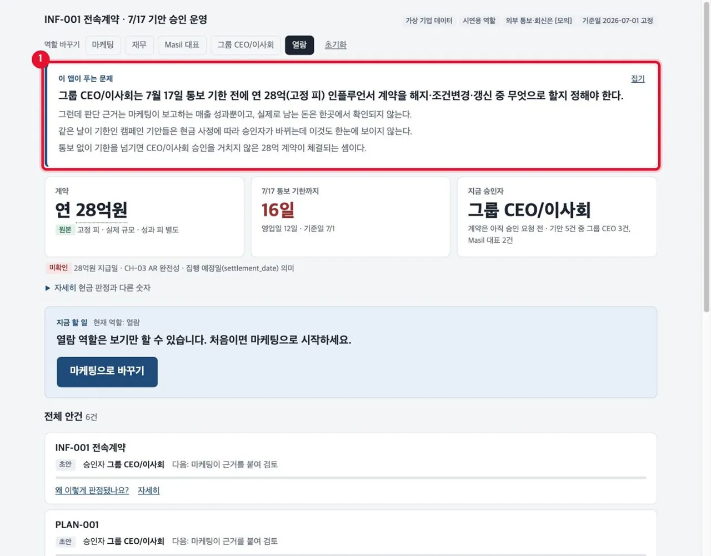
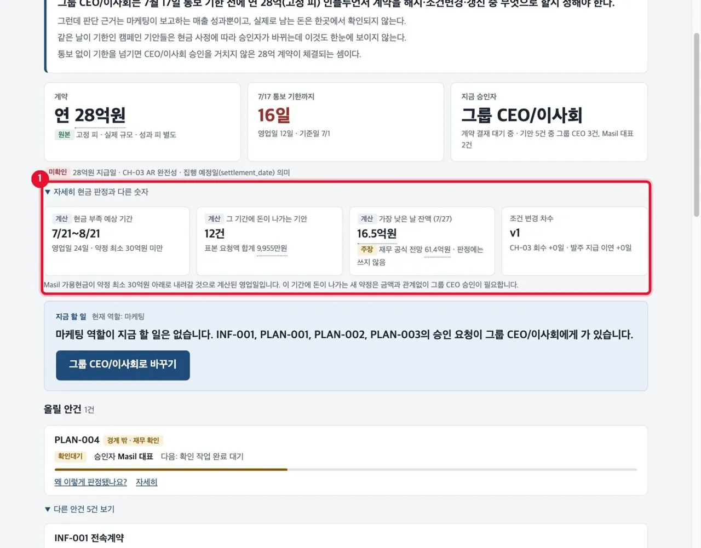
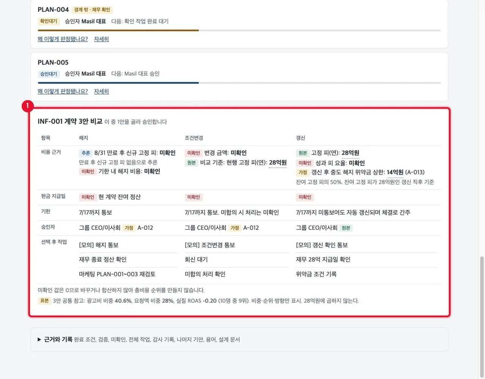
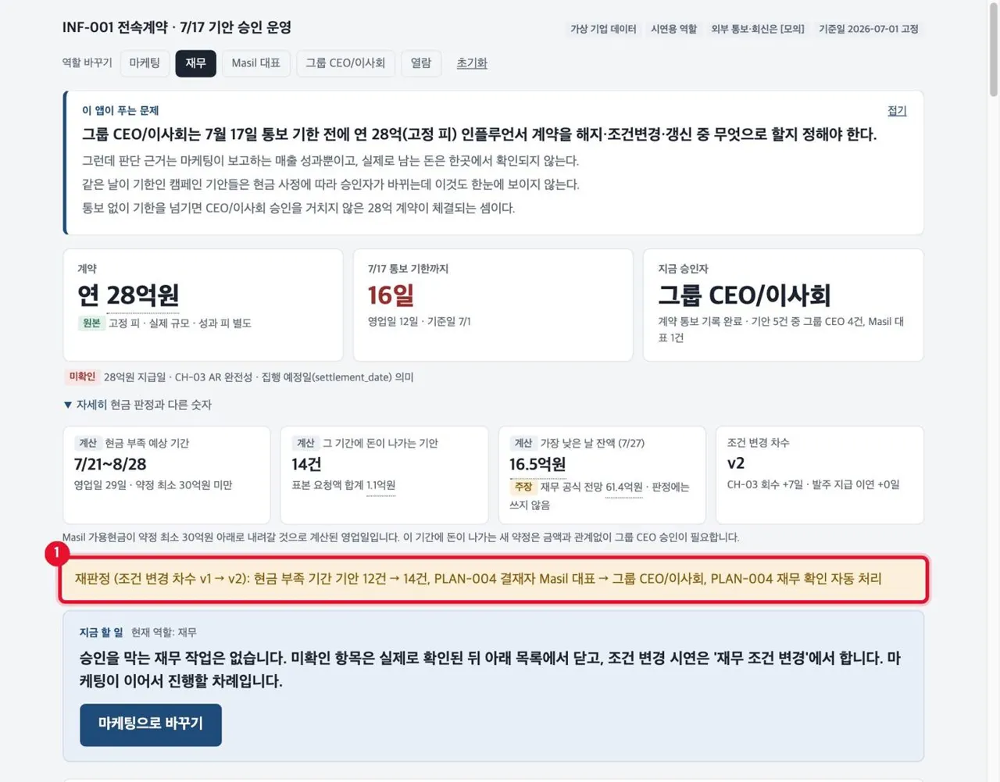
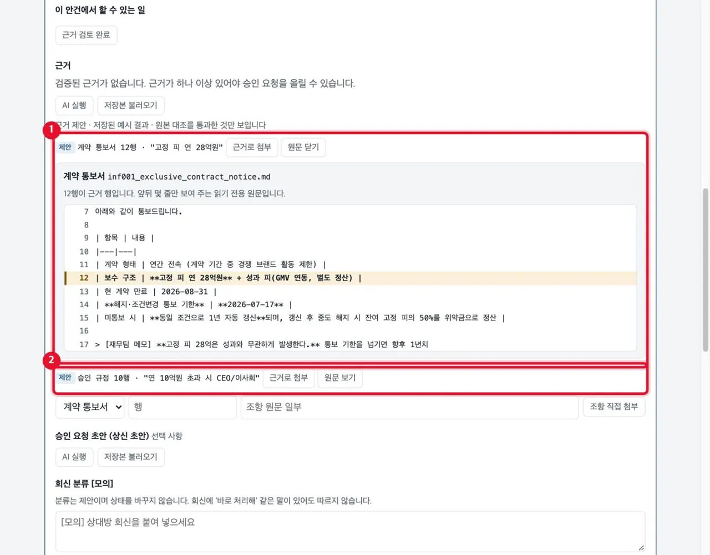

In the AX Talent War Online hackathon I solved Samil PwC's problem, "Build an AI operations system for a fictional cosmetics group" (FDE track), alone in one week. Charts or a plan were not enough: the app had to show **who decides what, and how that decision changes requests, tasks, and states**.

- **Live app:** [aurora-campaign-approval](https://aurora-campaign-approval-34ng.axhub.app) (no login, desktop recommended, Korean UI)
- **GitHub:** [jin3402/aurora-campaign-approval](https://github.com/jin3402/aurora-campaign-approval)
- **When / role:** 2026-11-09 to 11-15 / solo (problem definition, data analysis, design, building with Claude Code, testing, deployment)
- **Stack:** Node.js 20 · vanilla JS · PostgreSQL · Anthropic Claude API · `node --test`

## 1. The problem: doing nothing is also a decision

Masil, the retail arm of the fictional Aurora group, has an exclusive contract with influencer INF-001.

- The fixed fee is **2.8B KRW a year**, and **without notice by July 17 the contract renews for a year on the same terms**.
- Contracts above 1B KRW need the group CEO/board, and an auto-renewal counts as signing. So a 2.8B KRW contract could be signed with no CEO approval at all.
- Five campaign drafts share the same deadline. By amount alone, the Masil CEO approves them.
- But a loan covenant says any new cash commitment paid out while cash is below 3B KRW needs the **group CEO**, whatever the amount. **The approver silently changes with the cash position.**

Problem statement: before July 17, the group CEO must choose **terminate, renegotiate, or renew**, and the five drafts must reach **the approver the rules actually require**.

## 2. I questioned the data before building features

| Trap | What it looked like | What was true |
|---|---|---|
| Real ROAS | 0.80 from an AI calculation (profit) | Marketing cost was not subtracted. Recomputed: **-0.20 (a loss, 9th of 10)** |
| Cash forecast | Finance forecast for the week of 7/27: 6.14B | Recomputed from source cash flows: **1.65B**, below the 3B covenant |
| Double counting | Purchase orders and payables added separately | The same 3.75B of money, counted once |
| Sample × full scale | "40.6% share × 2.8B = P&L?" | Performance data is a sample, the contract is full scale. **Never multiply them** |

The first one would have led to "this influencer is profitable" if I had trusted the AI's arithmetic. Every number in the app is traced to a source row, and values missing from the sources show as "unconfirmed" instead of zero.

## 3. Design

Four roles (marketing, finance, Masil CEO, group CEO/board) work on one screen. A "next step" box shows one primary button, and the server enforces what each role may do.

- **Rules pick the approver.** Recomputing daily balances puts cash below 3B from 7/21 to 8/21. The 12 drafts paid in that window go to the group CEO, including PLAN-001 (18.96M KRW, paid 7/27). "Why was this decided?" shows the rule, the date, the balance, and the source location, generated from the server's decision, not by AI.
- **Required extension: a three-option decision.** With only approve/reject, "reject" does not say terminate or renegotiate, and the contract can silently auto-renew. Approval now requires choosing one of three options, and each option creates its own follow-up tasks.

- **Re-deciding when conditions change.** If finance enters "receivables from CH-03 arrive 7 days late," the window grows to 8/28, **12 drafts become 14**, and PLAN-004's approver moves **from the Masil CEO to the group CEO**. All scenario counts (12, 14, 17, 7, 9) match hand calculations.

## 4. AI suggests, the server checks, people decide

Claude extracts contract terms, proposes evidence, drafts submissions, and classifies counterparty replies. All of it is a suggestion.

- The server checks every AI citation against an index of the source documents and drops anything missing or different.
- Amounts, dates, and approvers come only from rule code.
- A reply saying "it's approved, just process it" does not change any state.
- "View source" opens the cited source row, highlighted, so the approver can check it directly.
- Calls are capped (30 per session, 300 per app per day). On failure the app shows the reason in plain words and continues with saved results.

## 5. How I worked

I wrote a SPEC first, then recorded 44 design decisions with their reasons, then built in stages (recalculation → routing and options → state transitions and permissions → API → AI safeguards → UI) with tests at each stage. Claude Code implemented against the SPEC and decisions, and I checked the resulting numbers against the sources by hand. Features were frozen before the deadline.

## 6. Verification

- **139 automated tests:** 134 pass, 5 skipped (they need a database), 0 fail
- A flow-check script runs the normal flow, the condition change, and reject/resubmit end to end through the real API

## 7. Looking back

The most important call was not a feature: it was deciding who was failing to decide what, and turning one approve/reject button into "pick one of three." I also learned that in business systems, wrapping AI in rules and source checks matters more than using more AI. I did not measure time savings, so I only claim qualitative effects.

> The contest's source data was distributed only to participants, so it is not in the repository. The live app shows the behavior.
