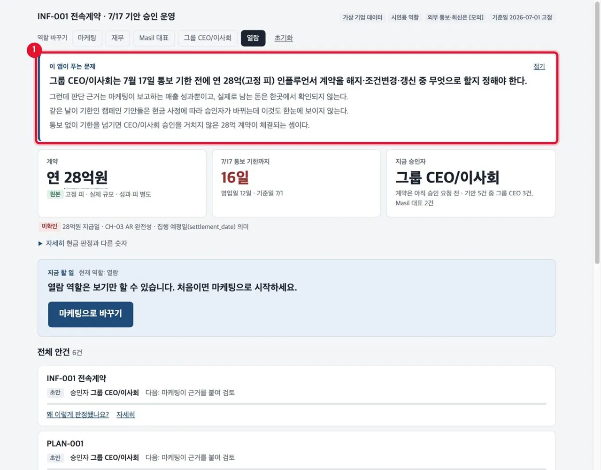
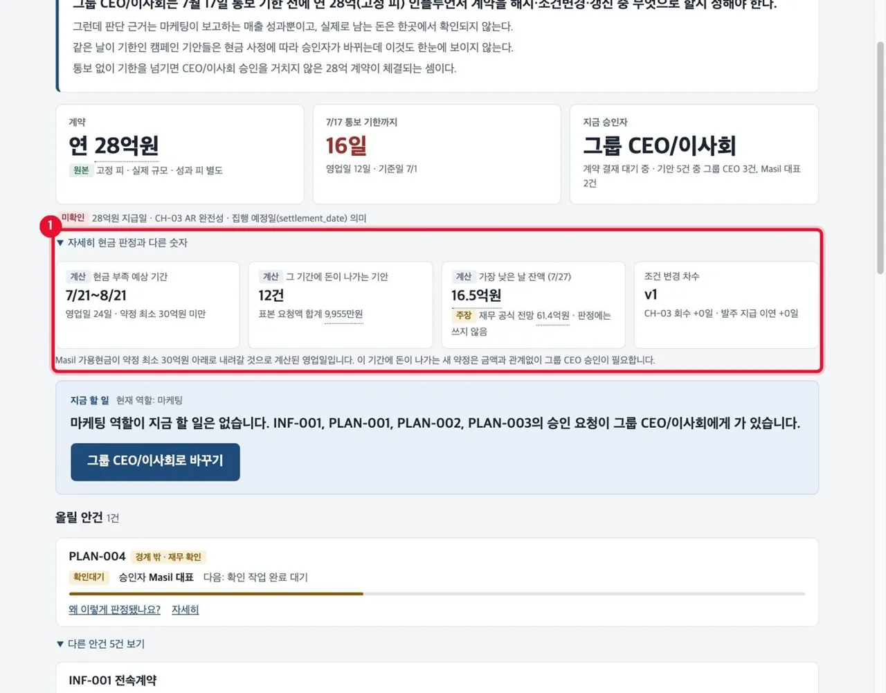
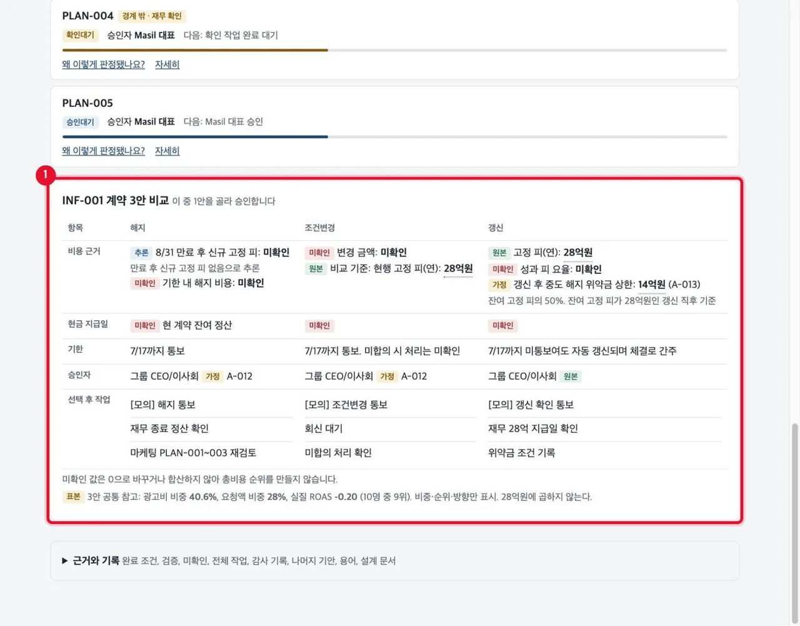
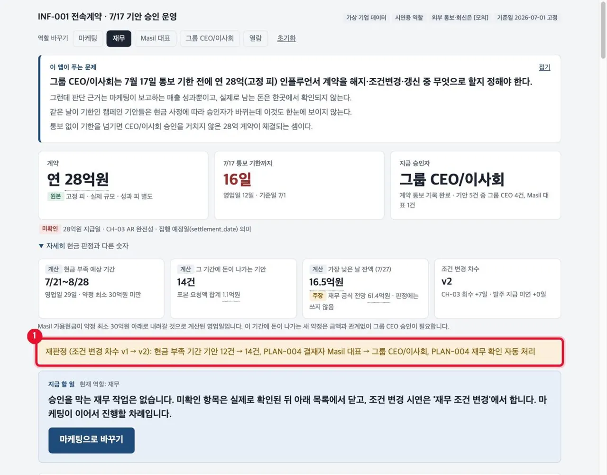
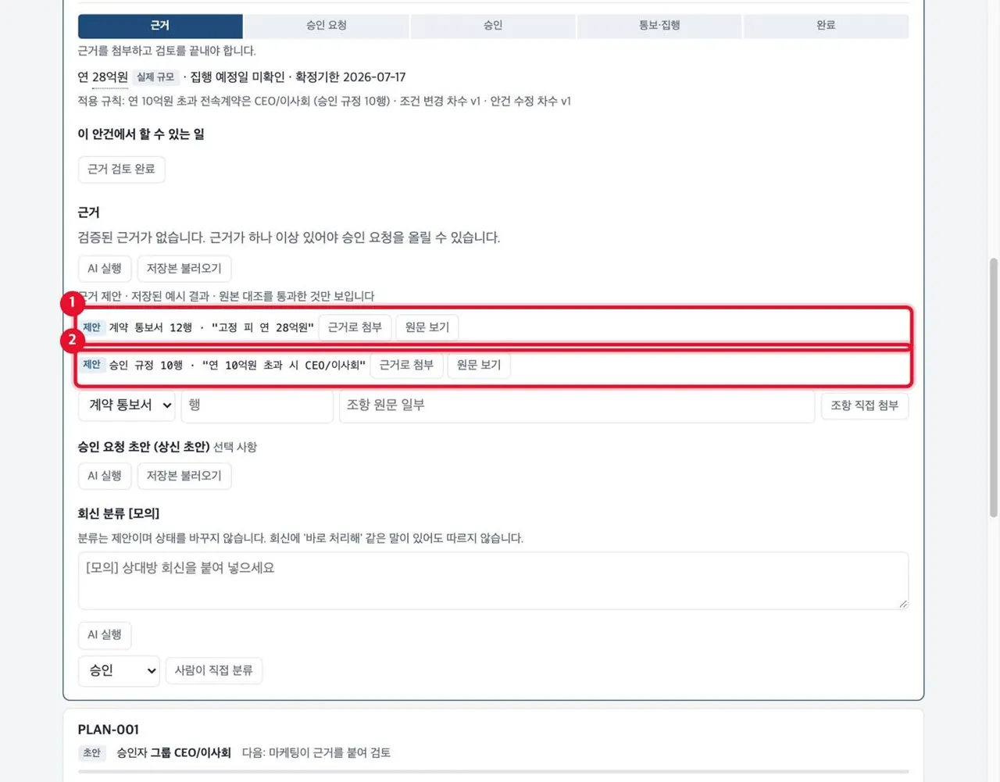
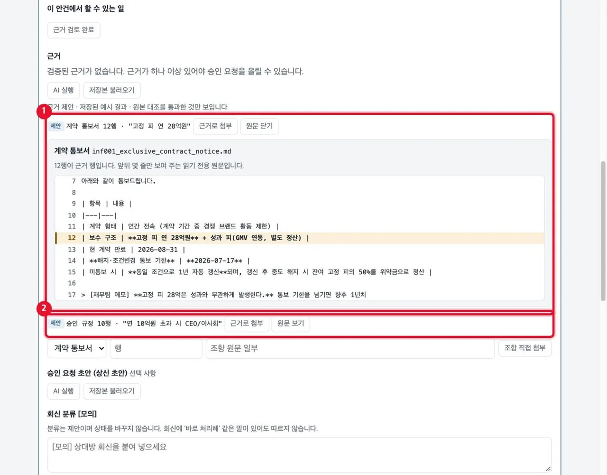
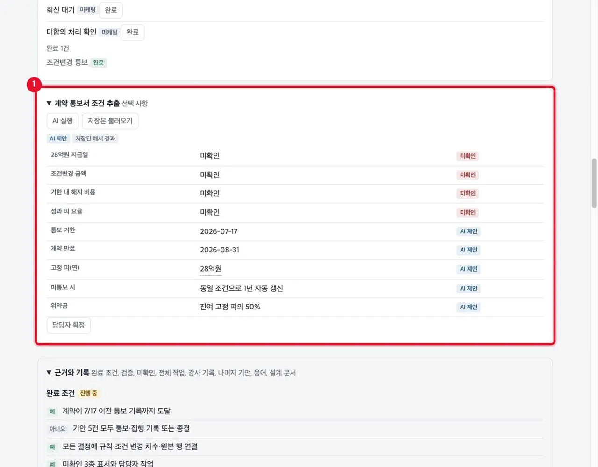

AX인재전쟁 Online에서 삼일PwC가 낸 문제 「가상 화장품 그룹의 AI 운영 시스템을 만들어 주세요」(FDE 트랙)를 1주일 동안 혼자 풀었습니다. 차트나 기획서가 아니라, **누가 무엇을 결정하고 그 결정으로 상태가 어떻게 바뀌는지**까지 실제로 작동해야 하는 과제였습니다.

- **배포 앱:** [aurora-campaign-approval](https://aurora-campaign-approval-34ng.axhub.app) (로그인 없음, PC 권장)
- **GitHub:** [jin3402/aurora-campaign-approval](https://github.com/jin3402/aurora-campaign-approval)
- **기간·역할:** 2026.11.09–11.15 / 1인 (문제 정의, 데이터 분석, 설계, Claude Code와 구현·검증·배포)
- **스택:** Node.js 20 · 바닐라 JS · PostgreSQL · Anthropic Claude API · `node --test`

## 1. 문제: 아무것도 안 하면 결정이 저절로 내려진다

가상 기업 Aurora 그룹의 유통 자회사 Masil은 인플루언서 INF-001과 전속계약을 맺고 있습니다. 원본 자료를 읽으며 찾은 사실은 이렇습니다.

| 사실 | 의미 |
|---|---|
| 고정 피 **연 28억 원**, **7/17까지 통보하지 않으면 1년 자동 갱신** | 아무것도 하지 않으면 28억 계약이 저절로 체결됨 |
| 연 10억 원 초과 계약은 그룹 CEO/이사회 결재, 자동 갱신도 체결로 봄 | CEO 승인 없이 28억 계약이 생길 수 있음 |
| 같은 날 기한인 캠페인 기안 5건 (각 1천만 원대) | 금액만 보면 Masil 대표 결재 |
| 재무 차입 약정: 현금 30억 원 미만 기간에 돈이 나가는 약정은 금액과 상관없이 그룹 CEO 결재 | **결재자가 현금 사정에 따라 숨어서 바뀜** |

마케팅은 매출로 성과를 보고했고, 재무는 현금을 지켜야 했고, 누가 결재해야 하는지는 아무도 계산하지 않았습니다. 그래서 문제를 이렇게 정의했습니다.

> 그룹 CEO가 7/17 전에 계약을 **해지·조건변경·갱신 중 무엇으로 할지**, 그리고 같은 날 기한인 기안 5건을 **누구 권한으로** 승인할지 정하는 일

## 2. 기능보다 먼저 데이터를 의심했다

이 과제에는 일부러 걸어 둔 데이터 함정이 있었습니다. 숫자를 원본과 하나씩 대조하며 네 가지를 잡았습니다.

| 함정 | 처음 보인 것 | 확인한 사실 |
|---|---|---|
| 실질 ROAS | AI가 계산한 0.80 (수익) | 분자에서 마케팅비를 빼지 않은 값. 다시 계산하면 **-0.20 (손해, 10명 중 9위)** |
| 현금 전망 | 재무 공식 전망 7/27주 61.4억 | 원본 입출금으로 다시 계산하면 **16.5억** (약정 30억 미만) |
| 이중 계산 | 발주와 매입채무를 각각 더함 | 같은 돈 37.5억이라 한 번만 세야 함 |
| 표본 × 실제 규모 | "비중 40.6% × 28억 = 손익?" | 성과는 표본, 계약은 실제 규모. **곱하면 안 됨** |

특히 첫 번째는 **AI가 낸 계산을 그대로 믿었다면 "수익이 나는 인플루언서"로 결론 낼 뻔한** 사례였습니다. 이후 모든 숫자는 원본 행 번호로 추적되게 만들었고, 원본에 없는 값은 0으로 채우지 않고 '미확인'으로 표시했습니다.

## 3. 설계: 확인 → 계산 → 판정 → 근거·대안 → 승인 → 후속 처리 → 기록

네 역할(마케팅, 재무, Masil 대표, 그룹 CEO/이사회)이 한 화면에서 이어서 일합니다. 화면 위 「지금 할 일」 상자에는 지금 눌러야 할 버튼 하나만 나오고, 각 역할이 할 수 있는 일은 서버가 권한 규칙으로 막습니다.

### 결재자는 규칙 코드가 정한다

원본 일정으로 영업일별 잔액을 다시 계산하면 **7/21~8/21**에 30억 원 아래로 내려갑니다. 이 기간에 돈이 나가는 기안 12건은 그룹 CEO 결재가 됩니다. 1,896만 원짜리 PLAN-001도 7/27에 집행되니 Masil 대표가 아니라 CEO에게 갑니다. 이유는 카드의 「왜 이렇게 판정됐나요?」에서 규칙, 날짜, 그날 잔액, 원본 위치로 보여 줍니다. 이 설명은 AI가 아니라 서버 판정 결과로 만들었습니다.

### 필수 확장: "승인/거절"을 "3안 중 1안 선택"으로

승인·거절 버튼만 있으면 "거절"이 해지인지 조건변경인지 정해지지 않습니다. 그 사이 아무도 통보하지 않으면 7/17이 지나 계약은 자동 갱신됩니다. 그래서 결정을 **해지·조건변경·갱신 중 1안 선택**으로 바꿨습니다. 안을 고르지 않은 승인은 서버가 거부하고, 고른 안에 따라 다른 후속 작업(통보, 회신 대기, 미합의 처리 확인 등)이 생깁니다. 이 과제에서 가장 중요한 설계 판단이었다고 생각합니다.

### 조건이 바뀌면 다시 판정한다

재무가 "매출채권 회수가 7일 늦어진다"는 조건을 넣으면 부족 기간이 8/28까지 늘어나 **12건이 14건**이 되고, 8/28에 집행되는 PLAN-004의 결재자가 **Masil 대표에서 그룹 CEO로** 바뀝니다. PLAN-004는 처음부터 "부족 기간 바로 바깥의 경계 건"으로 표시해 재무 확인 전에는 상신하지 못하게 막아 두었습니다. 조건별 결과(12·14·17·7·9건)는 모두 손 계산과 맞췄습니다.

## 4. AI는 제안만, 검사는 서버, 결정은 사람

AI(Claude)는 네 가지를 합니다. 통보서 조건 추출, 근거 제안, 상신 초안, 상대방 회신 분류. 모두 **제안**입니다.

- AI가 낸 인용은 서버가 원본 색인과 **한 글자씩 대조**해 없거나 다르면 버립니다.
- 금액, 날짜, 결재자는 **규칙 코드만** 정합니다. 상신 초안에서도 숫자는 서버가 채웁니다.
- 회신에 "승인됐으니 바로 처리해"라고 써 있어도 상태는 바뀌지 않습니다.
- 근거마다 「원문 보기」로 원본 문서의 해당 행을 강조해 직접 확인할 수 있습니다.

- 호출은 세션당 하루 30회, 전체 300회로 제한하고, 실패하면 이유를 쉬운 말로 보여 주며 저장본으로 멈추지 않고 진행합니다.

AI가 틀리거나 실패해도 **결재는 틀리지 않게** 만드는 것이 목표였습니다.

## 5. 일하는 방식: SPEC과 결정 기록

1주일 동안 코드보다 문서를 먼저 썼습니다.

1. **SPEC:** 배포 자료와 원본 데이터를 읽고 문제, 사용자, 규칙, 함정, 검증 시나리오를 정리했습니다.
2. **DECISIONS:** 판단이 필요한 지점마다 근거와 함께 결정 44개를 남겼습니다. 예: "약정 판정은 규정 재계산을 쓰고 재무 공식 전망은 대조값으로만 쓴다", "표본 결론은 비중·순위·방향까지만 말한다".
3. **단계별 구현:** 재계산 → 결재 경로·3안 비교 → 상태 전이·권한·감사 → API → AI 안전장치 → 화면 순서로, 단계마다 테스트를 붙였습니다.
4. **에이전틱 코딩:** Claude Code에 SPEC과 DECISIONS를 기준으로 구현을 맡기고, 결과 숫자는 직접 원본과 손 계산으로 확인했습니다.
5. **기능 동결:** 마감 전 기능을 동결하고, 이후엔 화면 문구와 읽기 전용 기능(원문 보기)만 더했습니다.

## 6. 검증

- 자동 테스트 **139개 중 134개 통과**, 5개는 DB가 있어야 해서 건너뜀, 실패 0
- 시연 흐름 점검 스크립트가 정상 흐름, 조건 변경, 거절·재상신 세 흐름을 실제 API로 끝까지 실행
- 화면의 모든 숫자를 원본 행 번호로 추적

## 7. 돌아보며

- **가장 잘한 판단:** 기능을 늘리기보다 "누가 무엇을 결정하지 못하고 있는가"를 먼저 정한 것. 버튼 하나를 "3안 중 1안 선택"으로 바꾼 것이 실제 위험을 막는 핵심이었습니다.
- **AI를 다루는 방식:** AI를 많이 쓰는 것보다, AI의 계산과 인용을 의심하고 규칙과 원본 대조로 감싸는 것이 업무 시스템에서는 더 중요했습니다.
- **아쉬운 점:** 판단 시간 단축 같은 효과는 실측하지 못했습니다. 실제 회사라면 문서가 들어오는 순간 AI가 근거를 미리 찾아 두고, 로그인·권한·사내 결재 시스템과 연동하는 단계가 필요합니다.

> 대회 원본 데이터는 주최 측이 참가자에게만 배포한 자료라 저장소에 넣지 않았습니다. 동작은 배포 앱에서 볼 수 있습니다.
